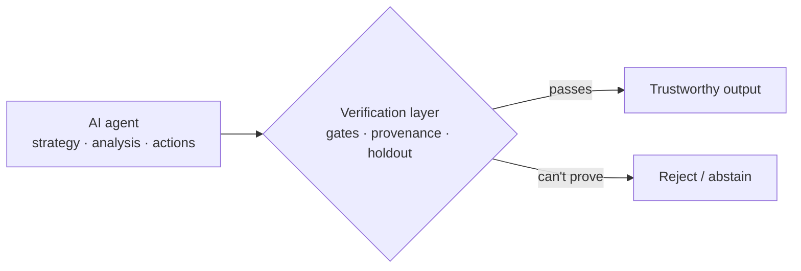

# CC Tsai

Final-year Mechanical Engineering student at **National Cheng Kung University**, moving into
research on **trustworthy AI agents for finance** — making AI-generated strategies and
analysis **reproducible, verifiable, and auditable**.

> The question I keep coming back to: when an AI can generate code, generate analysis, and
> even operate a system directly, **how do we confirm its output is trustworthy?** In finance
> this bites hard — a backtest that overstates performance, or an analysis that quietly
> invents a number, costs real money.

I work **agent-first**: I design the systems, specify the validation that decides
accept-or-reject, and judge the results; AI coding agents (Claude Code / Codex) do the
implementation. The part I care about — and want to research — is *the checking layer*.

### 🔬 Research direction

Trustworthy, auditable AI agents in quantitative finance, along two lines I'm prototyping.
Each line has a working prototype and a *measured* result — including the ones that went
against me.

- **Strategy trustworthiness** — can overfitting be caught reliably? Validation gates
  (trial registration · CSCV/PBO · DSR · single-use holdout · no-look-ahead contract) against
  a naïve-backtest baseline. **On record: three pre-registered FAILs, adjudicated and
  published rather than buried.**
- **Analysis faithfulness** — retrieval agents with a *provenance verifier*: every figure and
  citation must trace to a source, or the claim is blocked and the agent abstains. **Measured,
  not asserted:** 0% false positives on hand-built red-team suites, 0.06% on 10,000 pairs of a
  public benchmark nobody here wrote.

### 🧪 Strategy trustworthiness

- **[trialgate](https://github.com/0Smallcat0/trialgate)** — the validation gate as a
  zero-dependency, fully typed package on [PyPI](https://pypi.org/project/trialgate/): trial
  registry · CSCV/PBO · Deflated Sharpe · single-use holdout lock. The working prototype of
  this research line. It has already rejected one of my own strategies.
- **[tw-stock-trading](https://github.com/0Smallcat0/tw-stock-trading)** — that rejection, in
  full. Three pre-registered timing experiments on **21.2 years** of Taiwan 0050 total-return
  data, net of statutory costs. Drawdown protection passed (26.3% vs 55.8%); the CAGR cost
  failed the pre-registered claim (4.91%/yr vs 10.21% buy-and-hold). **Verdict: three FAILs,
  and per the stop rule the production runtime was never built.** The honest answer was
  buy-and-hold.
- **[crypto-quant-signal](https://github.com/0Smallcat0/crypto-quant-signal)** — the same six
  gates on a running crypto testbed: spot, long-only, public data, daily signals, a 1000 USDT
  paper scoreboard. Holdout still sealed; a ≥3-month paper qualification runs until October
  before the pass/fail report. No API keys, no live orders — by product definition. A
  two-minute offline demo replays 713 decision cycles with no network.

### 🧪 Analysis faithfulness

- **[report-workflow](https://github.com/0Smallcat0/report-workflow)** — a deterministic gate
  layer between an LLM and the document it hands you: a number, quote or reference that is not
  in your sources never reaches the page, and you are told which sentence and why. The gate
  itself calls no model. Evidence, not adjectives: **88.6% recall / 0% false positives** on a
  44-case red-team suite (all 15 attack families caught at 100%; the surviving evasions are
  kept in the test set on purpose), and **0.06% false positives / 99.7% block precision**
  out of domain on HaluEval's 10,000 QA pairs. On PyPI and shipped as an MCP server; 917
  tests, CI green.
- **[legal-agent](https://github.com/0Smallcat0/legal-agent)** — a RAG pipeline where every
  citation is checked by code, and *the checker is itself graded* by seeding errors into
  otherwise-correct answers: **11,904 / 11,904 caught, 0 false positives**. A time-sliced
  statute store cites the law in force at the event's date (`as_of=`), and the whole pipeline
  runs with no model, no key and no network — which is also how it is tested. My deepest
  system-design work, and the seed of this research direction.
  **[Live demo](https://huggingface.co/spaces/NoirOAO/legal-agent-demo)** — about thirty
  seconds; it ships a pre-filled broken answer to check for yourself.

### 🧪 Auditable agent operation

- **[otto](https://github.com/0Smallcat0/otto)** — a local financial terminal an AI operates
  end-to-end over MCP, one `claude mcp add` away. Two things make it a testbed rather than a
  toy. **Agent operability is a benchmark, not a tagline**: a real headless agent runs
  plain-language tasks in hermetic sandboxes, graded programmatically on terminal state and
  artifacts, never by an LLM judge (`claude-sonnet-5` **20/20** on the 20-task suite,
  2026-07-10 — the suite has since grown, so those figures are dated rather than current).
  And **safety is structural rather than switched off**: live trading and credential entry are
  unreachable through the surface the agent has, and refusal tasks are graded on *state
  unchanged*. It also keeps a scorecard of its own dated calls, and publishes it when the
  calls are bad.

### 🛠️ Also

- **[OpenRead](https://github.com/0Smallcat0/OpenRead)** — read the web and your PDFs in your
  own language without sending a word of it anywhere: Chrome's on-device translator by
  default (Ollama as a fallback engine), bilingual output under each paragraph, Traditional
  Chinese that reads like Taiwan. No account, no API key, no cloud.

### 👋 About

Self-taught career-changer (mechanical engineering → AI / quant finance). Strong at
decomposing problems, prototyping fast with AI tooling, and validation / risk thinking;
seeking graduate research training to deepen the statistics and evaluation methodology
behind all of it. 中文（母語）· English (C1) · 日本語（基礎）.

Since **August 2026** I've been in a mentored remote internship in quantitative research and
data engineering — the first work of this kind I'm doing to someone else's brief rather than
my own.
