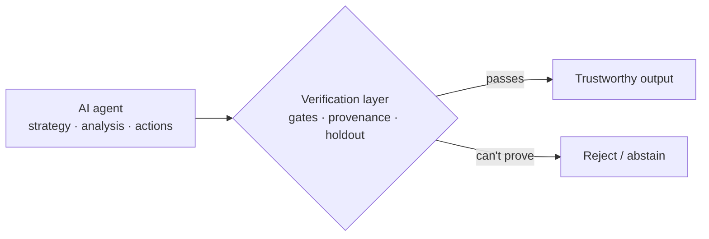

# CC Tsai

Final-year Mechanical Engineering student at **National Cheng Kung University**, working on
one question: when an AI can generate code, generate analysis, and operate a system directly,
**how do we confirm its output is trustworthy?** In finance this bites hard: a backtest that
overstates performance, or an analysis that quietly invents a number, costs real money.

I design the systems, specify the validation that decides accept-or-reject, and judge the
results. The part I care about is *the checking layer*.

### Research direction

**Emulation or recitation?** LLM trading agents placed in simulated markets show human-like
behavioural biases. My proposed study asks whether the agent *computes* that behaviour or
*recognises* it from its label. The agent gets identical numbers twice: once under field names
that name a known bias (purchase price, all-time high, unrealised P&L), once under neutral
names in random order. If the bias survives the renaming, the published result gets stronger;
if it disappears, the result needs narrowing. Either answer is a finding.

One research question, one primary outcome (the all-time-high anomaly effect size, named vs
de-named), with sample size, stop rule and multiple-comparison correction registered before
the first run. Platform: [PAMS](https://arxiv.org/abs/2309.10729); baseline:
FCLAgent ([arXiv:2510.12189](https://arxiv.org/abs/2510.12189)).

The projects below are the experimental discipline that study runs on: pre-registration,
single-use holdouts, and checkers that are themselves measured.

### Strategy validation

- **[trialgate](https://github.com/0Smallcat0/trialgate)** — stops you putting real money on
  a backtest that was only luck. A zero-dependency, `mypy --strict` library and CLI on
  [PyPI](https://pypi.org/project/trialgate/): a hash-chained registry records every backtest
  you run, then nine gates judge the best one (CSCV/PBO, Deflated Sharpe, single-use holdout,
  cost stress, stop-line survivability, live deviation bands). Reads freqtrade and Optuna
  runs directly, and exits 1 so it can block a deploy. Its 30-second demo finds an annualized
  Sharpe of 1.20 in a random walk across 450 configurations; the gates return NOT QUALIFIED.
- **[tw-stock-trading](https://github.com/0Smallcat0/tw-stock-trading)** — can a retail,
  long-only, public-data strategy beat buying and holding Taiwan's 0050 ETF? Four
  pre-registered routes on **21.2 years** of total-return data, net of statutory costs, each
  judged once against a claim written down before any backtest ran. The trend rule cut the
  worst drawdown to 26.3% against 55.8%, at 4.91%/yr against buy-and-hold's 10.21%. No route
  met its pre-registered claim, so by the stop rule the production runtime was never built
  and the holdout stays sealed. Separate AI agents were asked to overturn the verdict and
  could not: a benchmark rebuilt from outside sources deviated 0.0pp.
- **[crypto-quant-signal](https://github.com/0Smallcat0/crypto-quant-signal)** — a daily
  spot, long-only signal system behind six gates, with a 1000 USDT paper scoreboard and no
  API keys or live orders by product definition. **133 registered trials across eleven
  pre-registered families**; the best candidate cleared the deflation gate (DSR 0.9505) and
  was then run unchanged on 21 years of Taiwan data, which showed it was a fit, not an edge.
  The program closed on 2026-10-16 with the single-use holdout never opened and every
  pre-registration, result and correction committed. A two-minute offline demo replays 713
  decision cycles with no network.

### Analysis faithfulness

- **[report-workflow](https://github.com/0Smallcat0/report-workflow)** — give your AI the
  files you already have and one sentence; get back a Word document you can hand in. A
  number, quote or reference that is not in your files never reaches the page, and you are
  told which sentence and why. The gate calls no model. **89.1% recall / 0% false positives**
  on a 73-case hand-audited red-team suite, and **0.11% false positives (11/10,000) / 99.6%
  block precision** on HaluEval's 10,000 QA pairs, a public benchmark nobody here wrote. Its
  reference checker caught 30 of 33 problem references in a hand-verified set of 104, and all
  13 it called wrong were wrong. On [PyPI](https://pypi.org/project/report-workflow/) and
  shipped as an MCP server for Claude Code, Codex and Cursor; 1,471 tests, CI green.
- **[legal-agent](https://github.com/0Smallcat0/legal-agent)** — understand your situation
  before you pay a lawyer: describe the dispute in everyday words and get the governing
  Taiwan statutes, the steps from free mediation to court, and judgments citing the same
  articles. Every citation is checked by code, and *the checker is itself graded* by planting
  errors into correct answers: **100% caught in each of 24 error kinds, 0 / 3,758 false
  positives**, across 3,758 articles of 18 statutes. Against the bare model, citations a
  reader would have to take on trust fall from **67% to 5%**. A time-sliced statute store
  cites the law in force on the event's date (`as_of=`), and the pipeline runs with no model,
  no key and no network. My deepest system-design work.
  **[Live demo](https://huggingface.co/spaces/NoirOAO/legal-agent-demo)** — about thirty
  seconds; it ships a pre-filled broken answer to check for yourself.

### Auditable agent operation

- **[otto](https://github.com/0Smallcat0/otto)** — a local financial terminal an AI agent
  operates for you over MCP: market data, backtests, paper books and news, driven in plain
  language on your own machine. **It keeps score**: every call the agent records (a
  stance, the reasoning, the price that would prove it wrong) is graded later against the
  price the market printed and against its index. **"An AI can operate it" is measured**: a
  real headless agent runs plain-language tasks in hermetic sandboxes, graded on terminal
  state and artifacts, never by an LLM judge. `claude-sonnet-5` and `claude-haiku-4-5` both
  pass **21 / 21** (2026-08-16). Live trading and credential entry are unreachable through
  the surface the agent has. One typed contract of 142 actions drives the MCP tools, the UI
  and the eval suite; 805 tests on Windows and Linux CI.

### Mechanical design

- **[mechanical-design-demos](https://github.com/0Smallcat0/mechanical-design-demos)** — a
  design portfolio that opens in the browser, nothing to install.
  **[Open it](https://0smallcat0.github.io/mechanical-design-demos/)**. A CD-11 cycloidal
  reducer (3,000 rpm in, 272.7 rpm out, 11:1) you can explode, cut away and load harder,
  with forces, stress and bearing life calculated live from the same motion, plus
  engineering drawings and STEP files. And a 4.2 × 5.0 m studio furnished with six real
  IKEA Taiwan products, each built to the size on its product page.

### Also

- **[OpenRead](https://github.com/0Smallcat0/OpenRead)** — immersive translation costs money,
  so I built the free one. Bilingual translation for web pages, PDFs, EPUB books and YouTube
  captions, on the
  [Chrome Web Store](https://chromewebstore.google.com/detail/mopclgoefogojkfmigfjpbmnnoiodnmb):
  Chrome's on-device translator by default, so no account, no API key and no quota.
  Thirty-nine target languages, and Traditional Chinese that reads like Taiwan.
- **[samelight](https://github.com/0Smallcat0/samelight)** — beauty ads compare two different
  photos; SameLight makes them compare two faces. **[Live app](https://samelight.pages.dev)**.
  It brings a before/after pair to the same focus, exposure and colour, then measures the
  skin again with the YouCam Skin Analysis API. Tested with known answers: camera tricks
  alone showed +88 points in the ad and +2 under the same light; a real skin change kept
  145 of 161.

### About

Mechanical engineering → AI and quantitative finance. Strong at decomposing problems,
prototyping fast with AI tools, and validation / risk thinking. Applying for graduate study
starting in 2027. 中文（母語）· English (C1) · 日本語（基礎）.

In **August–September 2026** I completed a mentored remote internship in quantitative
research and data engineering.
